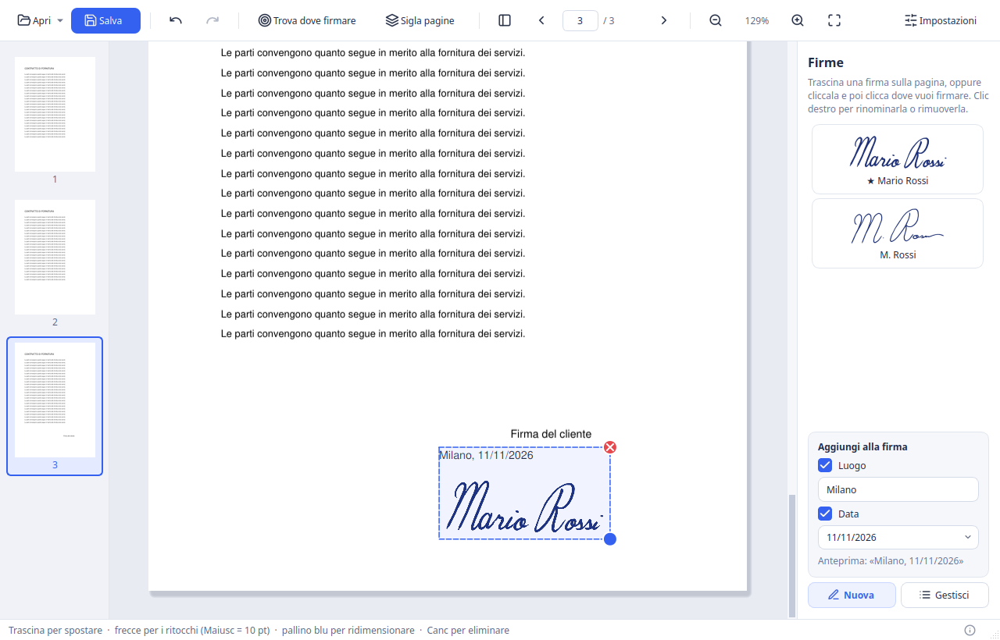
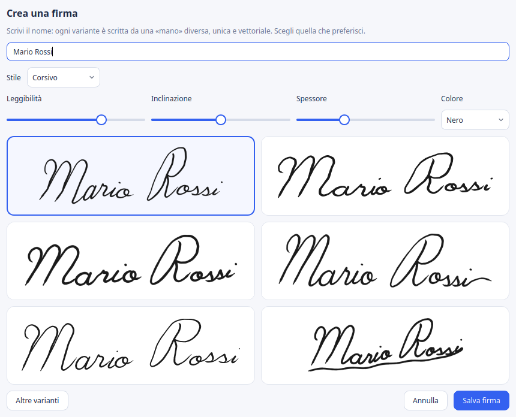
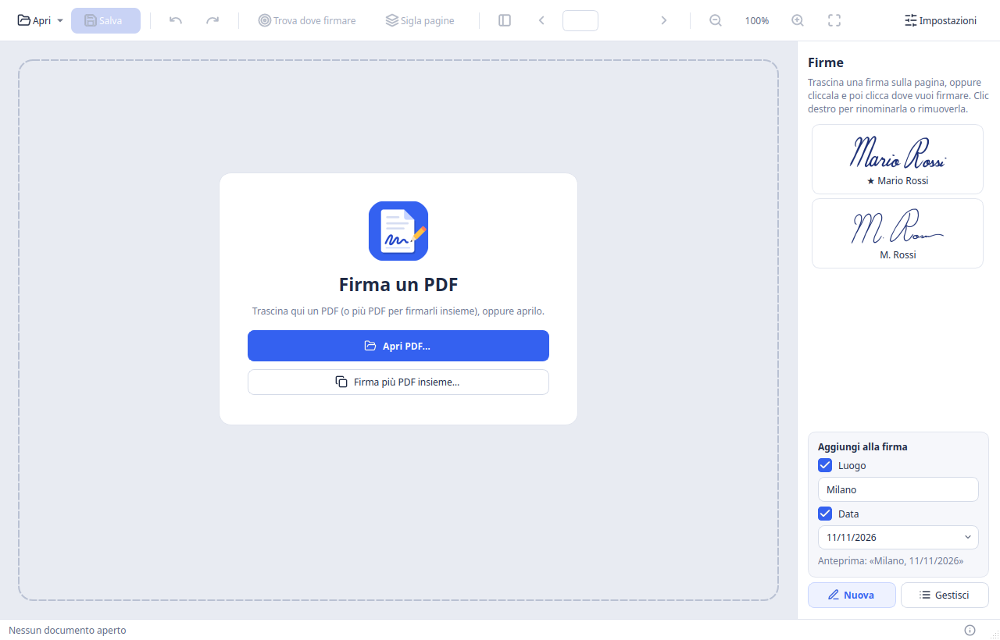

<p align="center">
  
</p>

<h1 align="center">Syglami-PDF</h1>

<p align="center">
  <b>Sign your PDFs by dragging your signature onto the page.</b><br>
  Linux desktop app · vector signatures · place and date · batch signing · everything stays local
</p>

<p align="center">
  
</p>

---

## What it does

Syglami-PDF opens a PDF, lets you place your signature where it is needed and saves the signed document, either as a copy or by overwriting the original. It works offline: your documents and signatures never leave your computer. The only network access is an optional check for a newer version at startup.

The interface is in Italian.

> **Note.** Syglami-PDF applies a *graphic* signature (the image of your signature), just like signing a printed sheet and scanning it. It is **not** a qualified digital signature (PAdES/CAdES with a certificate). If the PDF already contains a digital signature, saving it invalidates that signature.

## Features

**Signing**
- **Drag and drop** the signature onto the page, or click it and then click where to sign: the cursor becomes a stamp and a preview shows the result.
- **Find where to sign** (Ctrl+F): searches the text for «Firma», «Il dichiarante», «Letto e sottoscritto», «In fede»… and puts the signature there. If there are several spots it lists them; if there are none it signs at the bottom of the last page.
- **Initial the pages**: a small signature in the margin of every page, as in contracts.
- Optional **place and date** above the signature (e.g. «Milano, 11/11/2026»).
- Several signatures per document: move, resize, delete, nudge with the arrow keys, **undo/redo**.
- Signatures always stay inside the sheet; rotated pages are handled correctly.

**Your signatures**
- **Signature creator**: type the name and choose among 6 variants, each written by a different "hand". It does not use fonts: it simulates slant, rhythm, pressure and tremor. There are 7 styles (Corsivo, Calligrafico, Stampatello, Professionale, Elegante, Frettolosa, Sigla), legibility, slant, thickness, colour (black by default) and an «Underlined» checkbox for the line under the name.
- **Import** your signature from PNG, JPG or SVG; images are converted to **vector SVG**, sharp at any zoom level and in print.
- **Draw** the signature with the mouse or a graphics tablet: the stroke thins out with speed or follows the pen pressure.
- **Default signature** (★) used by the automatic functions.
- At the bottom of the *Firme* column: **Nuova** lets you choose between *Importa*, *Genera* and *Disegna*; **Gestisci** opens *Le mie firme* (rename, set as default, remove). **Right-clicking** a signature does the same on the fly.

<p align="center">
  
</p>

**Several documents**
- **Scan effect** (optional checkbox): the saved PDF looks printed, hand-signed and scanned — greyscale pages, slightly skewed, scanner contrast, grain, a few specks and faint vertical streaks in the margins. The flaws are random, different at every save, and never cover the content. Text is no longer selectable.
- **Sign several PDFs at once**: automatic position, bottom of the last page, or the same as in the open document; creates `name_firmato.pdf` or overwrites.

**Settings**
- What *Salva* does: ask every time, always create a copy, always overwrite.
- Name of the copy (e.g. `_firmato` or `_firmato_{data}`), date format, recent files.
- **Export and import your signatures** as a .zip file, for a backup or another computer.

**Conveniences**
- Page thumbnails, zoom, recent files, open by drag and drop.
- Password-protected PDFs stay protected after signing.
- Safe saving: the file is written aside and replaced only once writing has succeeded.
- Remembers place, options, signature width and window position.
- **Updates**: at startup the app reads the latest release number from GitHub. If you installed the `.deb` package, an **Update** button downloads the new package, checks it (size, SHA-256 published by GitHub, package name and version) and installs it after you enter your password; then the app offers to restart. If you run it from the source folder, the button opens the download page instead, so your folder is never touched. No data is sent, and the check can be turned off in the settings.

<p align="center">
  
</p>

## Installation

The easiest way is to download a ready package from the [latest release](https://github.com/giuseppeCappadonna/Syglami-PDF/releases/latest):

- **Ubuntu / Debian**: `syglami-pdf_<version>_amd64.deb` — double-click it, or `sudo apt install ./syglami-pdf_*.deb`. Later versions install themselves from the app (**Update** button).
- **macOS (Apple Silicon)**: `Syglami-PDF-<version>-macos-arm64.zip` — unzip it and move **Syglami-PDF.app** to *Applications*. The app is not signed by Apple: the first time, macOS blocks it; open *System Settings → Privacy & Security* and click **Open Anyway**. On macOS the app tells you about new versions but you download them by hand.

### From source (Linux)

Requirements: Linux with GNOME (tested on Ubuntu 24.04), Python 3.10+, system PyQt6 and NumPy.

1. Download the project from [GitHub](https://github.com/giuseppeCappadonna/Syglami-PDF) with **Code → Download ZIP** and extract it where you want to keep it.
2. In a terminal, inside the extracted folder:

```sh
sudo apt install python3-venv python3-pyqt6 python3-numpy
./install.sh
```

`install.sh` creates a virtual environment with the dependencies (`pymupdf`, `potracer`, `Hershey-Fonts`) and registers:
- **Syglami-PDF** in *Show Applications* and in *Open With* for PDFs;
- the app icon.

You can run it again whenever you like, for example after moving the folder.

### Building the packages

To build a `.deb` (the app plus PyMuPDF, potracer and Hershey-Fonts; PyQt6 and NumPy come from the system):

```sh
script/build-deb.sh                    # creates build/syglami-pdf_<version>_<arch>.deb
sudo apt install ./build/syglami-pdf_*.deb
```

The package installs the app in `/opt/syglami-pdf`, the `syglami-pdf` command and the launcher. Remove it with `sudo apt remove syglami-pdf`.

The macOS app is built on a Mac with `script/build-mac.sh` (PyInstaller); the `macos.yml` GitHub workflow does it automatically and attaches the zip to every published release.

To start it from a terminal (folder install):

```sh
./firma.sh document.pdf      # opens the PDF
```

## How to use it

1. **Open** a PDF (*Apri* button, recent files, or drag it onto the window).
2. **Drag your signature** from the right-hand column onto the sheet, or press **Trova dove firmare**.
3. Optional: tick **Luogo** (place) and **Data** (date), move or resize the signature.
4. Press **Salva** and choose *Salva una copia firmata…* (save a signed copy) or *Sovrascrivi l'originale* (overwrite the original).

The first time, press **Nuova** at the bottom of the *Firme* column and choose whether to **import** an image of your real signature, **generate** one or **draw** it.

### Shortcuts

| Keys | Action |
|---|---|
| Ctrl+O / Ctrl+S | Open / Save |
| Ctrl+Z / Ctrl+Shift+Z | Undo / Redo |
| Ctrl+F | Find where to sign |
| Ctrl+Shift+S | Initial all pages |
| F4 | Show/hide thumbnails |
| PgUp / PgDn | Previous / next page |
| Ctrl + wheel, Ctrl+− / Ctrl++, Ctrl+0 | Zoom, fit to width |
| Arrows (Shift = 10 pt) | Move the selected signature |
| Del | Delete the selected signature |
| Esc / right click | Cancel placement |
| Ctrl+, / F1 | Settings / About |

## Where the data is

| What | Where |
|---|---|
| Settings and signature list | `~/.config/firma_pdf/config.json` |
| Your signatures (internal copies) | `~/.config/firma_pdf/firme/` |
| Graphics cache | `~/.cache/sigla/` |

Personal signatures are **not** part of the repository.

## Development

```
firma_pdf.py      entry point (python firma_pdf.py [file.pdf])
sigla/config.py   configuration and signature store (no Qt)
sigla/pdf.py      writing signatures into PDFs and automatic placement (no Qt)
sigla/aggiornamenti.py  check for a newer version on GitHub (no Qt)
sigla/ui/         PyQt6 interface: theme, scene, widgets, dialogs, main window
generatore.py     "handwritten" signature creator (Hershey skeletons + hand simulation)
vettorizza.py     PNG/JPG → SVG conversion (potrace)
app.json          app name, app version, signature algorithm version, author, licence, links
tests/test_app.py headless end-to-end test
install.sh        installation for the current user
script/build-deb.sh  builds the .deb package into build/
```

Tests:

```sh
QT_QPA_PLATFORM=offscreen venv/bin/python tests/test_app.py   # prints "OK"
venv/bin/python generatore.py                                  # generator self-check
```

Versions follow [SemVer](https://semver.org/): the app name, the app version and the signature algorithm version live in `app.json`, the changes in [CHANGELOG.md](CHANGELOG.md) (in Italian).

## Credits

- [PyMuPDF](https://pymupdf.readthedocs.io/) for rendering and writing PDFs
- [PyQt6](https://www.riverbankcomputing.com/software/pyqt/) for the interface
- [potracer](https://pypi.org/project/potracer/) for vectorisation
- [Hershey](https://pypi.org/project/Hershey-Fonts/) single-line fonts as the skeleton of the generator's letters
- Icons derived from [Lucide](https://lucide.dev/), [ISC License](https://lucide.dev/license): Copyright (c) Lucide Contributors 2022; portions Copyright (c) Cole Bemis 2013-2022 as part of Feather (MIT)

## Author

**Giuseppe Cappadonna**

## License

Copyright © 2026 Giuseppe Cappadonna.

[GNU AGPL-3.0](LICENSE), with no warranty. Anyone who receives the app is entitled to its source code; the licence is required by PyMuPDF (AGPL-3.0) and PyQt6 (GPL-3.0).
